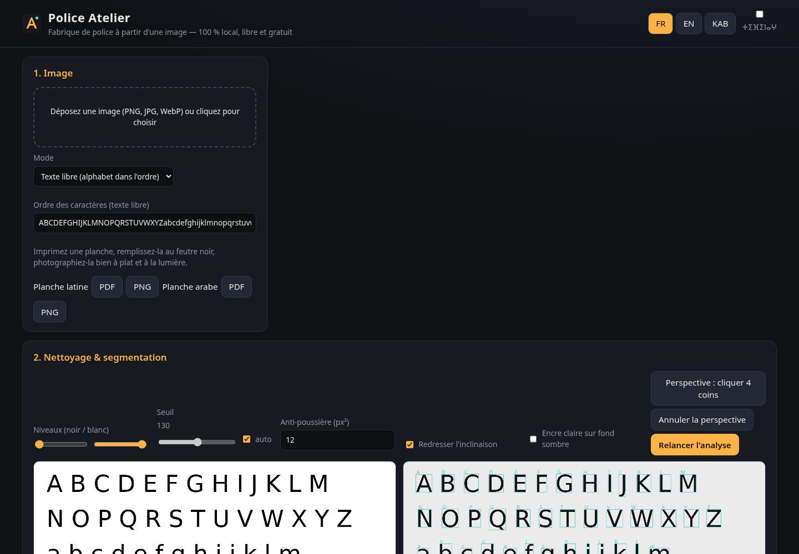
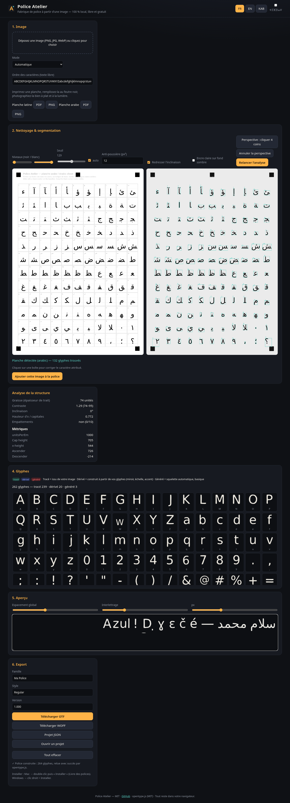

# Police Atelier

**Fabrique de police à partir d'une image — libre, gratuite, 100 % locale.**
Déposez une photo ou un scan de lettres : Police Atelier analyse la structure des lettres, les vectorise et vous livre un fichier **OTF prêt à installer** avec toutes les lettres et tous les chiffres. Latin (français, kabyle) **et arabe** (formes positionnelles + ligature lam-alif).

👉 **Démo : https://salimadour31-boop.github.io/police-atelier/**



## Ce que fait l'outil

1. **Image** : PNG, JPG ou WebP. Deux modes :
   - **Planche modèle** (recommandé) : imprimez [la planche latine](docs/planche-latine.pdf) (A-Z, a-z, 0-9, ponctuation, é è ê à ç ù ô î ë ï û œ æ, č ǧ ḥ ɛ ɣ ṛ ṣ ṭ ẓ ḍ) ou [la planche arabe](docs/planche-arabe.pdf) (28 lettres, ء أ إ آ ؤ ئ ة ى لا dans toutes leurs formes isolée/initiale/médiane/finale, chiffres ٠-٩, ، ؛ ؟), remplissez-la au feutre noir, photographiez-la. Les 4 marques noires permettent un redressement automatique de la perspective. Versions PNG : [latine](docs/planche-latine.png), [arabe](docs/planche-arabe.png) ; elles sont aussi téléchargeables depuis l'application.
   - **Texte libre** : une ligne d'alphabet écrite dans l'ordre (l'ordre est modifiable). Le sens droite→gauche est détecté si l'ordre contient de l'arabe.
2. **Nettoyage & segmentation** : niveaux, seuil d'Otsu (ou manuel), anti-poussière, redressement de l'inclinaison, correction de perspective en 4 clics, détection encre claire / fond sombre. Composantes connexes, fusion des points (i, j, points arabes), accents et points souscrits, ordre de lecture. Cliquez sur une boîte pour corriger le caractère attribué.
3. **Vectorisation maison** : contours « marching squares » + ajustement de courbes de Bézier cubiques (moindres carrés, détection des angles), sens de rotation correct pour les contre-formes. Normalisation à 1000 unités/em : ligne de base, hauteur d'x, capitales, ascendantes et descendantes détectées statistiquement.
4. **Analyse de la structure** : graisse, contraste, inclinaison, rapport hauteur d'x/capitales, empattements.
5. **Glyphes manquants**, toujours signalés dans la grille :
   - *dérivé* : miroir/rotation (b↔d, p↔q, n↔u, 6↔9…), capitale ↔ minuscule mise à l'échelle, accents composés (é = e + aigu, avec l'accent détecté dans vos glyphes si possible), œ/æ, lettres hamzées ;
   - *généré* : squelette au trait épaissi à la graisse mesurée (basique), formes arabes positionnelles manquantes = forme existante + trait de liaison (kashida) à la ligne de base.
   La police contient toujours A-Z, a-z, 0-9, l'espace et la ponctuation de base.
6. **Édition** : décalage de ligne de base, échelle, approches par glyphe ; espacement global, interlettrage ; aperçu en direct (API FontFace) ; nom de famille, style, version.
7. **Export** : **OTF** (CFF, via opentype.js), **WOFF**, **projet JSON** (réouvrable). Tables name, OS/2, hhea, post, cmap ; pour l'arabe : cmap des lettres de base **et** des formes de présentation B, GSUB `init`/`medi`/`fina` + `rlig`/`liga` (lam-alif).

Interface en **français**, **anglais** et **taqbaylit** (traduction au mieux, à relire), avec affichage optionnel en **tifinagh**.

## Installer la police

- **Mac** : double-cliquez sur le fichier `.otf` → **Livre des polices** (Font Book) s'ouvre → **Installer**.
- **Windows** : clic droit sur le fichier `.otf` → **Installer** (ou « Installer pour tous les utilisateurs »).
- Web : utilisez le `.woff` avec `@font-face`.

## Limites (honnêtes)

- Les photos d'écriture manuscrite demandent un **bon contraste** (feutre noir, papier blanc, lumière uniforme, pas d'ombre). Le stylo bille fin ou le crayon donnent des résultats médiocres.
- En texte libre, les lettres doivent être **séparées** : des lettres attachées (cursive, arabe lié) forment un seul bloc. Pour l'arabe, utilisez la planche.
- Les glyphes **générés** sont des squelettes simples, pas du dessin typographique : remplacez-les en les dessinant.
- Pas de crénage automatique ni de hinting ; pas d'export TTF (contours quadratiques) pour l'instant — l'OTF s'installe partout.
- La traduction kabyle et la translittération tifinagh sont à relire par des locuteurs.

## Développement

Pur HTML/CSS/JS, aucune compilation, aucun serveur : ouvrez `index.html` (ou servez le dossier). Seule bibliothèque : [opentype.js](https://github.com/opentypejs/opentype.js) 1.3.4 (MIT), dans `vendor/` avec sa licence.

```
js/imageproc.js  niveaux, Otsu, anti-poussière, deskew, homographie
js/segment.js    composantes connexes, fusion des signes, ordre de lecture
js/trace.js      marching squares + Bézier cubiques, rastérisation, IoU
js/analyse.js    graisse, contraste, inclinaison, empattements, métriques
js/pipeline.js   enchaînement planche / texte libre -> glyphes en unités
js/synth.js      dérivation, composition, squelettes, formes arabes
js/fontbuild.js  OTF (opentype.js), GSUB arabe, WOFF
js/template.js   planches PNG/PDF   ·   js/i18n.js  FR/EN/KAB + tifinagh   ·   js/app.js  interface
```

Tests :

```bash
npm install
npm test          # tests unitaires : tracé, segmentation, métriques, analyse, synthèse, export
npm run e2e       # Chrome sans tête (bureau 1440 px + mobile 390 px) + validation Python
pip install fonttools opentype-sanitizer uharfbuzz pillow numpy
```

Le test de bout en bout rend l'alphabet de **DejaVu Sans** (police libre, utilisée uniquement comme entrée de test) en image, puis remplit les deux planches avec la même police ; il fait tourner le pipeline, exporte l'OTF, le charge avec **fontTools**, le passe à **OTS** (ots-sanitize), vérifie la cmap (A-Z, a-z, 0-9, bloc arabe), la présence de GSUB, la mise en forme HarfBuzz de « سلام » / « محمد » et dans Chrome via FontFace, et compare les glyphes tracés à l'original (**IoU > 0,8** exigé), sans erreur console.



---

### English summary
Police Atelier turns a photo or scan of letters (template sheet or free alphabet line) into an installable **OTF** font, entirely in your browser. It cleans the image, segments glyphs (merging dots and accents), traces them to cubic Béziers with its own tracer, measures metrics and structure (weight, contrast, slant, x-height ratio, serifs), fills missing glyphs (derived or clearly flagged as generated) and exports OTF, WOFF and a JSON project. Latin (French, Kabyle) and **Arabic** with positional forms and OpenType GSUB (init/medi/fina, lam-alef). MIT licence.

### Agzul s Teqbaylit (tasuqqilt s wazal n tazwart)
Police Atelier yettarra tawlaft n isekkilen d tasefsit **OTF** i tzemreḍ ad tesbeddeḍ, deg yiminig-ik kan, war aqeddac. Yesizdig tugna, yebḍa isekkilen, yesuneɣ-iten, yettak-d tasleḍt n teɣessa, yerennu isekkilen ixuṣṣen (yettwacreḍ « yettwasirew »), sakin yessufuɣ OTF, WOFF d JSON. Latinit (tafransist, taqbaylit) d taɛrabt. Turagt MIT.
